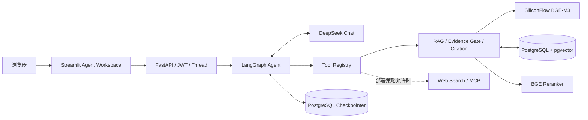

# LangGraph-RAG-Agent

一个使用 **FastAPI、LangGraph、PostgreSQL/pgvector 和 Streamlit** 的 AI Agent + RAG Workspace。
原仓库：[721keep/LangGraph-RAG-Agent](https://github.com/721keep/LangGraph-RAG-Agent)。

新版 Agent Workspace 提供左侧导航与会话列表、轻量模型/知识库工具栏、独立知识库和文档管理、
流式对话、工具执行摘要与可折叠详情、Citation 来源卡片。默认浅色，支持深色主题；原创节点网络 Logo
及 29 个本地 Lucide 图标随源码分发，不依赖图标 CDN。

## 能力与技术栈

- 多知识库与 PDF / DOCX / TXT 上传，显示 processing / ready / failed 状态；超时结果不确定时主动核验，避免自动重传。
- LangGraph Agent 使用 Tool Calling 选择 RAG、Web Search 或 MCP 工具；工具状态与模型回答分开显示。
- 独立配置 Chat、Embedding 与 Reranker；已验证 DeepSeek 官方 Chat、SiliconFlow 非 Pro BGE-M3 和 BGE Reranker。
- pgvector 检索、重排序、Evidence Gate 与文档/页码/Chunk 引用；不凭向量维度推断模型兼容性。
- JWT 用户认证、Thread 权限检查、PostgreSQL Checkpointer、多轮对话和历史恢复。
- Python、FastAPI、LangChain/LangGraph、PostgreSQL、pgvector、MCP、Streamlit；保留原有评估工具。



## 新版独立部署

需要 Git、Python 3 和 Docker Engine/Desktop + Compose v2；构建时需要下载基础镜像与锁定依赖。
已验证环境为 Windows Docker Desktop / WSL、容器 Python 3.12.11。
干净机器不需要已有 M4、Stage3 容器或私有测试配置。

```bash
git clone https://github.com/721keep/LangGraph-RAG-Agent.git
cd LangGraph-RAG-Agent
# 当前发布变更尚在 fix/rag-upload-reliability；发布后使用包含本 README 的提交/分支。
python3 -m venv .venv-tools
# Linux/WSL: source .venv-tools/bin/activate
# Windows PowerShell: .venv-tools\Scripts\Activate.ps1
python -m pip install -r deployment/release/requirements-tools.txt
```

首次安装在本地私有 `.env` 中填写下列字段，不把值粘贴到命令行、Issue 或日志。
已存在 `.env` 的机器保留原文件；不要覆盖旧配置。

| 字段 | 用途 |
|---|---|
| `CHAT_API_KEY` | DeepSeek 官方 API |
| `EMBEDDINGS_API_KEY` | SiliconFlow BGE-M3 |
| `RERANK_API_KEY` | SiliconFlow BGE Reranker，可独立密钥 |
| `TAVILY_API_KEY` | 当前 Settings / prepare 所需；默认部署不开放真实搜索 |

```bash
# 仅全新安装运行一次；已生成私有配置时跳过，脚本拒绝覆盖。
python deployment/release/manage.py prepare
python deployment/release/manage.py build
python deployment/release/manage.py up
```

访问 **http://127.0.0.1:18510**。Backend 与 PostgreSQL 不发布宿主机端口。
prepare 生成独立数据库密码与 JWT，保存到 Git 忽略的 `deployment/release/.private/`；
轮换 JWT 会使旧签名登录令牌失效。请安全备份 runtime、数据库密码、实例身份证明与持久卷。
Windows 权限加固及原生 Linux Secret 读取注意事项见 [部署说明](deployment/release/README.md)。

```bash
python deployment/release/manage.py stop      # 停止本部署，保留全部数据
python deployment/release/manage.py ps
python deployment/release/manage.py logs
python deployment/release/manage.py build     # 源码更新后重建镜像
python deployment/release/manage.py recreate  # 使用同一已验明的持久卷重建容器
```

### 当前模型开关：默认关闭

**页面可启动不代表已开放日常模型调用。** 默认 `RELEASE_MODEL_MODE=off`，后端仅连接 internal 网络，
HTTP Transport 阻断模型外发，Chat/上传返回受控 503。登录、知识库/文档列表、历史等不依赖模型的功能仍可使用。

R2 的 `bounded` 入口只用于已授权验收，限定用户、PDF、问题、HTTP 次数与 Token；历史账本已封存，
不能重置或重新 arm。它需要私有验收计划和已校验 tokenizer，不是干净安装或日常使用步骤。

日常模式尚需单独实现：保留三连接/实例/Collection 校验，新增显式、默认关闭的 daily 模式与新运行账本，
在 HTTP 发送前检查每模型/每日请求与 Token 上限、固定模型/域名、零自动重试和失败熔断；
资源范围改用正常认证及知识库权限，替换验收白名单。只开放必要的模型出口，搜索/MCP 另行授权。
本次发布准备没有实现或启用 daily 模式，也没有放开旧账本或网络。

## 数据与模型隔离

| 新版 profile | 固定配置 |
|---|---|
| Compose 项目 / PostgreSQL | `rag-release-r1` / `langgraph_rag_bge_prod` |
| Collection / 持久卷 | `bge_m3_1024_v1` / `rag_release_r1_pgdata_v1` |
| Chat | `deepseek-flash`，DeepSeek 官方 API |
| Embedding | `BAAI/bge-m3`，OpenAI 兼容 `/v1/embeddings`，1024 维 |
| Reranker | `BAAI/bge-reranker-v2-m3`，SiliconFlow `/v1/rerank` |

业务、向量、Checkpointer 使用同一新 PostgreSQL 实例的独立业务表和检查点表；启动前校验真实连接与实例身份。
旧 `docker-compose.yml` / `env.example` 是保留的 legacy 路径，默认 `my_collection`，不是新版启动入口。
旧集合中的 271 条历史向量完整保留，没有迁移或混用；相同维度也不能与 BGE-M3 混检。
旧 ready 文档不会自动成为新集合的有效资料，需未来独立授权的导入/重建与状态核对。

## 测试与验证边界

[测试指南](tests/README.md) 提供禁网离线回归和本地 Mock UI 测试。
[验证记录摘要](docs/VALIDATION.md) 区分模拟、真实数据库与历史真实供应商验收。
R2 真实验收完成 DeepSeek 3 次、Embedding 2 次、Reranker 1 次 HTTP 200，涵盖 PDF、RAG、Citation、
多轮、重启恢复与真实删除；本轮 R3 只执行离线回归，没有新增模型请求。
实际 Token 和费用依供应商账单，历史成功不承诺之后账户、服务或网络状态。

## 已知限制

- 默认安全部署尚不能直接用于持续真实聊天/上传，daily 受控模式是后续工作。
- 原生 Linux 的私有文件权限与 Compose Secret 非 root 读取策略尚未独立验收。
- Streamlit 刷新可能丢失仅保存在浏览器会话中的结构化工具面板，历史文本可从 Checkpointer 恢复。
- Citation 的页码、Chunk、分数只显示后端实际返回字段；不会伪造缺失数据或降低 Evidence Gate 阈值。
- 后台上传仍非持久任务队列，进程中断后的 processing 状态需要核验；不要因超时自动重传。
- Web Search/MCP 保留原架构，但新版安全部署默认不开放外部调用。

## License

MIT，保留原 [LICENSE](LICENSE)。本地 Lucide SVG 按其随附 ISC License 分发。
